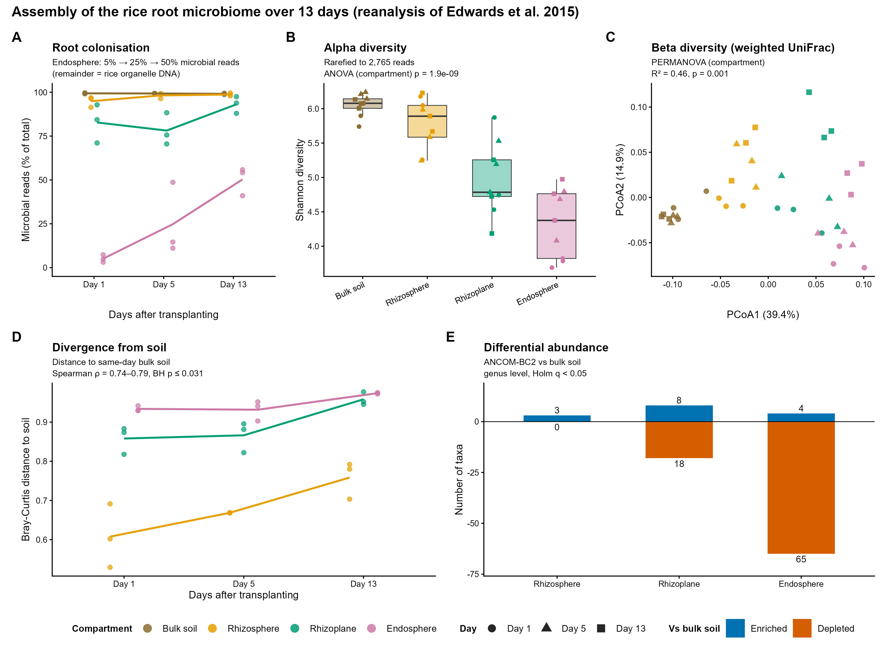

# Rice Root Microbiome Assembly — 16S rRNA Reanalysis in R

A reproducible reanalysis of the rice root-microbiome **time-series experiment** of Edwards *et al.* (2015, *PNAS*), from raw paired-end reads in the Sequence Read Archive to statistical testing and a publication-quality figure, using **R / Bioconductor** (DADA2, phyloseq, vegan, ANCOM-BC2).

The original study clustered reads into 97 % OTUs with QIIME 1. Here the same raw data were reprocessed into **amplicon sequence variants (ASVs)** with current methods, to test whether the paper's main conclusions about how rice roots assemble their microbiome still hold.



**Figure 1.** (A) Share of reads that are microbial rather than rice organelle DNA, by compartment and day. (B) Shannon diversity by compartment (rarefied to 2,765 reads). (C) PCoA of weighted UniFrac distances. (D) Bray–Curtis distance of each root-associated sample to bulk soil sampled on the same day. (E) Genera enriched or depleted in each root compartment relative to bulk soil (ANCOM-BC2).

---

## Key findings

1. **Bacteria colonise the root interior within days.** Seedlings were germinated sterile. In the endosphere, microbial reads rose from **5 % on day 1 to 25 % on day 5 and 50 % on day 13** (the rest being rice chloroplast and mitochondrial DNA), reproducing the colonisation pattern in Edwards *et al.* Fig. 6A.
2. **Diversity falls from soil to root interior.** Observed ASVs: bulk soil 832, rhizosphere 738, rhizoplane 474, endosphere 230 (two-way ANOVA, compartment p < 10⁻¹³). Bulk soil and rhizosphere did not differ (p = 0.09); the same gradient held for Shannon diversity and Faith's phylogenetic diversity, and at a second rarefaction depth.
3. **Compartment is the dominant driver of community composition.** Root compartment explained 17–46 % of variation (PERMANOVA, p = 0.001). The weighted UniFrac effect (**R² = 0.46**) closely matches the 0.47 reported in the original study. Communities were ordered along the first PCoA axis by proximity to the root.
4. **Root communities diverge from soil over time.** Relative to same-day bulk soil, all three root compartments became progressively more distinct over 13 days (e.g. rhizosphere Bray–Curtis 0.61 → 0.67 → 0.76; Spearman ρ = 0.74–0.79, BH-adjusted p ≤ 0.031), indicating active, time-dependent restructuring by the plant.
5. **The root acts as a series of filters.** The number of genera depleted relative to soil increased toward the root interior (rhizosphere 0, rhizoplane 18, endosphere 65), while few were enriched (3, 8 and 4). Acidobacteriota, Planctomycetota and Gemmatimonadota fell 10- to 17-fold from soil to endosphere, while Pseudomonadota rose from 15 % to 41 %, as in the original study.
6. **Root-associated taxa.** Rhodocyclaceae and Comamonadaceae were enriched in all root compartments, as reported by Edwards *et al.*; genera containing nitrogen fixers (*Azotobacter*, *Klebsiella*, *Clostridium*) were significantly enriched in the rhizosphere or rhizoplane.

---

## Dataset

| | |
|---|---|
| Study | Edwards J *et al.* (2015) Structure, variation, and assembly of the root-associated microbiomes of rice. *PNAS* 112:E911–E920 |
| Accession | NCBI SRA **SRP044745** |
| Subset used | Time-series experiment: rice cv. M104 transplanted as sterile seedlings into Davis field soil (greenhouse) |
| Design | 4 compartments (bulk soil, rhizosphere, rhizoplane, endosphere) × 3 days (1, 5, 13) × 3 replicates = **36 samples** |
| Sequencing | Illumina MiSeq, paired-end 2 × 247 bp, 16S rRNA **V4** (515F–806R), 3.2 million read pairs |

The sample list with accessions is in `data/sample-metadata.csv`.

---

## Workflow

| Script | What it does |
|---|---|
| `00_setup_packages.R` | Installs all packages |
| `02_download_ena.R` | Downloads 36 paired-end runs from ENA with MD5 verification (2 runs missing from ENA were taken from NCBI SRA with `fasterq-dump`) |
| `03_inspect_reads_primers.R` | Read counts, lengths, primer detection, quality profiles |
| `04_quality_filtering.R` | Tests three truncation settings; filters pairs (truncLen 230/160, maxEE 2/2) |
| `05_dada2_asv.R` | Error models, denoising, merging pairs, length check, chimera removal, read tracking |
| `06_taxonomy.R` | SILVA 138.2 naive Bayes classification (in chunks, to limit memory) |
| `07_feature_table.R` | phyloseq object; microbial vs organelle reads over time; removal of organelles and non-target sequences |
| `08_alpha_diversity.R` | Rarefaction; Observed, Shannon, Pielou; two-way ANOVA (compartment × day), sensitivity at 10,000 reads |
| `09_beta_diversity.R` | Alignment, distance matrix, FastME tree; Faith's PD; Jaccard, Bray–Curtis and UniFrac; PCoA |
| `10_permanova.R` | PERMANOVA (compartment × day), pairwise tests, day effects, divergence from soil, dispersion |
| `11_taxonomic_composition.R` | Phylum and genus composition; taxa highlighted in the original study |
| `12_differential_abundance.R` | ANCOM-BC2: each root compartment vs bulk soil, adjusted for day |
| `13_publication_figure.R` | Figure 1 (PNG and PDF) |

### Processing summary

| Step | Result |
|---|---|
| Primers | Already removed by the submitters: read starts match the bases immediately downstream of 515F and 806R |
| Quality filtering | 2,680,086 of 3,200,654 read pairs kept (83.7 %); truncation 230/160 chosen from three tested settings |
| Denoising and merging | 99.9 % of merged reads within 250–256 bp; 310 chimeric ASVs removed (0.8 % of reads) |
| ASVs | 8,705 after chimera removal; 8,466 after removing non-target sequences |
| Host DNA | 25.8 % of reads were rice organelle DNA: mitochondria (16.8 %, all 251 bp) and chloroplasts (8.8 %); removed before analysis |
| Depth after cleaning | 2,765–99,222 reads per sample (median 51,273) |
| Taxonomy | 74 % of ASVs classified to family, 40 % to genus (typical for soil); 62 archaeal ASVs, including the methanogens *Methanobacterium*, *Methanosarcina* and *Methanocella* |

---

## Comparison with the original study

| Result | Edwards *et al.* (2015) | This reanalysis |
|---|---|---|
| Diversity gradient | Highest in rhizosphere, lowest in endosphere | Same; bulk soil ≈ rhizosphere > rhizoplane > endosphere |
| Rhizosphere vs bulk soil alpha diversity | Not significantly different | Not significantly different (p = 0.09) |
| Compartment effect (weighted UniFrac) | 46.6 % of variation | 46.0 % of variation |
| Most similar compartments | Rhizoplane and endosphere | Rhizoplane and endosphere (Bray–Curtis p = 0.18) |
| Endosphere colonisation | Microbial reads begin rising within 24 h and continue to rise over 2 weeks | 5 % → 25 % → 50 % on days 1, 5, 13 |
| Phyla depleted in endosphere | Acidobacteria, Planctomycetes, Gemmatimonadetes, Chloroflexi, Verrucomicrobia | Same groups dominate the 65 depleted genera |
| Rhodocyclaceae, Comamonadaceae | Enriched in all root compartments | Enriched in all root compartments |
| *Pleomorphomonas*, Spirochaetes | Enriched in roots | Not detected at appreciable levels in these 1–13-day-old seedlings |
| Alpha diversity over time | Only bulk soil varied significantly | Bulk soil varied (p = 0.044); endosphere diversity also rose (Shannon 3.8 → 4.7, p = 0.015), neither surviving correction for multiple testing |

Methods differ in several ways (ASVs vs 97 % OTUs, SILVA 138.2 vs Greengenes, a 36-sample subset, ANCOM-BC2 vs negative binomial models), so the comparison is of **patterns and effect sizes**, not exact numbers.

---

## Biological interpretation

**A multistep assembly process.** The results support the model proposed by Edwards *et al.*: microbes are first recruited from soil into the rhizosphere, a subset attaches to the root surface, and a still smaller subset enters the root. The rhizosphere mainly enriches taxa and removes none; the rhizoplane both enriches and excludes; the endosphere is the most exclusive compartment. Taxa depleted on the rhizoplane were also depleted inside the root, consistent with the root surface acting as a gate.

**Rapid colonisation.** The root interior of sterile seedlings is almost free of bacteria on day 1 and reaches about half microbial reads by day 13. As colonisation proceeds, the endosphere community broadens: Chloroflexota dominate on day 1 (34 %) and give way to Bacillota and other phyla by day 13.

**Active restructuring, not passive sampling.** Bulk soil itself changed over the experiment, but root communities diverged further from same-day soil over time. The plant therefore shapes its microbial neighbourhood progressively, rather than simply hosting what the soil provides.

**Same species richness, different community.** Rhizosphere and bulk soil had the same alpha diversity but clearly different composition (PERMANOVA R² 0.19–0.39), showing that root influence near the surface works mainly by changing *which* taxa are abundant, not how many there are.

**Functional hints.** Root-enriched genera include nitrogen fixers (*Azotobacter*, *Klebsiella*, *Clostridium*) and groups known for plant-polymer degradation or predation (*Sorangium*, *Herpetosiphon*, Fibrobacterota). 16S data show which taxa are present, not what they are doing, so these are hypotheses for functional follow-up.

---

## Limitations

- **Subset of the original study.** 36 greenhouse time-series samples from one cultivar and one soil; results on soil type, genotype and field conditions were not reanalysed.
- **Small groups.** Three replicates per compartment and day limit power for time effects; within-compartment time trends in alpha diversity did not survive correction for multiple testing.
- **Low microbial biomass in the early endosphere.** Day-1 endosphere samples contained only ~5 % microbial reads (2,765–5,297 reads after organelle removal), so early endosphere composition rests on little bacterial DNA.
- **Rarefaction.** The main alpha and beta analyses use the depth of the shallowest sample (2,765 reads), which underestimates richness in soil; conclusions were confirmed at 10,000 reads (32 samples).
- **Dispersion.** Compartments differed in within-group spread (betadisper p = 0.001; bulk soil the most homogeneous), so PERMANOVA reflects both location and dispersion, although PCoA shows clearly separated groups.
- **Conservative differential abundance.** Genus-level aggregation, Holm correction and a pseudo-count robustness filter make the enriched and depleted counts much lower than in the original OTU-level analysis.
- **Taxonomic resolution.** V4 reads assign 40 % of ASVs to genus and few to species; soil contains many uncultured lineages.

---

## Repository structure

```
Rice-Root-Microbiome-16S-R/
├── scripts/                 # Analysis scripts, run in numerical order
├── data/
│   ├── sample-metadata.csv  # 36 samples: run accession, compartment, day
│   ├── ena-manifest.csv     # Downloaded files, checksums and source
│   ├── raw/                 # Raw FASTQ (git-ignored; downloaded by script 02)
│   ├── reference/           # SILVA files (git-ignored; downloaded by script 06)
│   └── processed/           # Intermediate R objects (.rds)
├── results/
│   ├── figures/             # All figures, including Figure 1
│   └── tables/              # All result tables (.csv)
├── docs/
│   └── sessionInfo.txt      # R and package versions used
└── Rice-Root-Microbiome-16S-R.Rproj
```

---

## How to reproduce

1. Clone the repository and open `Rice-Root-Microbiome-16S-R.Rproj` in RStudio.
2. Run `scripts/00_setup_packages.R` once (R ≥ 4.4, Bioconductor).
3. Run the scripts in order, `02` to `13`. Raw reads (~0.9 GB) and SILVA reference files are downloaded automatically.
   - Two runs (SRR2107429, SRR2107479) are listed but not available on ENA's file server; download them with the NCBI SRA Toolkit (`fasterq-dump --split-files`), as described in `02_download_ena.R`.
   - The slow steps (DADA2, taxonomy, tree) save their progress and can be resumed by re-running the script.
4. Package versions are recorded in `docs/sessionInfo.txt`.

Tested on Windows 11 with R 4.4.1 using a single core (`multithread = FALSE`); on macOS/Linux, DADA2 steps can be sped up with `multithread = TRUE`.

---

## References

- Callahan BJ, *et al.* (2016) DADA2: High-resolution sample inference from Illumina amplicon data. *Nature Methods* 13:581–583.
- Callahan BJ (2024) Silva taxonomic training data formatted for DADA2 (Silva version 138.2). Zenodo. doi:10.5281/zenodo.14169026
- Desper R, Gascuel O (2002) Fast and accurate phylogeny reconstruction algorithms based on the minimum-evolution principle. *Journal of Computational Biology* 9:687–705.
- Edwards J, *et al.* (2015) Structure, variation, and assembly of the root-associated microbiomes of rice. *PNAS* 112:E911–E920.
- Faith DP (1992) Conservation evaluation and phylogenetic diversity. *Biological Conservation* 61:1–10.
- Kembel SW, *et al.* (2010) Picante: R tools for integrating phylogenies and ecology. *Bioinformatics* 26:1463–1464.
- Lin H, Peddada SD (2024) Multigroup analysis of compositions of microbiomes with covariate adjustments and repeated measures. *Nature Methods* 21:83–91.
- Lozupone C, Knight R (2005) UniFrac: a new phylogenetic method for comparing microbial communities. *Applied and Environmental Microbiology* 71:8228–8235.
- McMurdie PJ, Holmes S (2013) phyloseq: an R package for reproducible interactive analysis and graphics of microbiome census data. *PLoS ONE* 8:e61217.
- McMurdie PJ, Holmes S (2014) Waste not, want not: why rarefying microbiome data is inadmissible. *PLoS Computational Biology* 10:e1003531.
- Oksanen J, *et al.* vegan: Community Ecology Package. R package.
- Paradis E, Schliep K (2019) ape 5.0: an environment for modern phylogenetics and evolutionary analyses in R. *Bioinformatics* 35:526–528.
- Quast C, *et al.* (2013) The SILVA ribosomal RNA gene database project. *Nucleic Acids Research* 41:D590–D596.
- Wright ES (2016) Using DECIPHER v2.0 to analyze big biological sequence data in R. *The R Journal* 8:352–359.

---

## Editor

**Harshani Hathurusinghe**
GitHub: [@Harshi7493](https://github.com/Harshi7493) · [LinkedIn](https://www.linkedin.com/in/harshani-hathurusinghe-0b417034)

